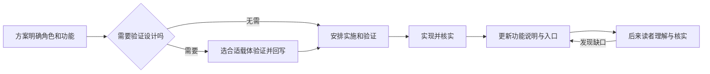

# Lumine Harness

Lumine Harness 把项目规则、方案、实施和知识放在仓库中。人可以阅读项目当前的能力和约束，Agent 可以找到同样的解释、规范和来源。换了会话，长期任务和已核实结论仍能继续使用。

## 你可以做什么

- **为仓库接入 Lumine。** [选择语言、项目根与宿主](lumine-adoption)，核对要安装和保留的内容。
- **迭代一个功能。** [从方案到交付](lumine-workflow)确认目标、按需设计，执行后留下实际验证和功能解释。
- **理解项目如何工作。** [在浏览器查找功能、读图和核实依据](lumine-wiki-reader)，也可让 Agent 按当前问题定位实现。
- **纠正知识。** [先判断变化影响了哪些解释](reader-explanation)，再[用可恢复的变更包](lumine-wiki)一起调整正文、图示和入口，保留人工内容与历史证据。

## 从功能到可复用的知识

方案表达预期，验证记录说明实际检查，知识页面告诉后来读者当前功能如何运行。知识按变更范围维护，持续迭代使用同一文档和任务身份。

## 开发与运行

从 [协作开发指南](lumine-collaboration-guide) 和 [常用指令与阅读器](lumine-command-guide) 开始。理解源码和构建时，查看 [Core、Skill、Adapter 与分发](lumine-architecture)；维护本仓先读取根 AGENTS。

<!-- lumine-wiki-metadata:v1
{
  "aliases": [
    "卢米安",
    "项目协作",
    "功能知识",
    "wiki home"
  ],
  "repositories": [
    "project"
  ],
  "sources": [
    {
      "id": "entry",
      "repoId": "project",
      "path": "README.zh-CN.md",
      "kind": "source"
    },
    {
      "id": "knowledge",
      "repoId": "project",
      "path": "skills/lumine-harness/assets/skills/lumine-knowledge/SKILL.md",
      "kind": "source"
    },
    {
      "id": "flow",
      "repoId": "project",
      "path": "skills/lumine-harness/assets/skills/lumine-run/SKILL.md",
      "kind": "source"
    },
    {
      "id": "reader",
      "repoId": "project",
      "path": "skills/lumine-harness/src/browser/reader.tsx",
      "kind": "source"
    },
    {
      "id": "navigation",
      "repoId": "project",
      "path": "skills/lumine-harness/src/harness/wiki/navigation.ts",
      "kind": "source"
    }
  ],
  "sections": [
    {
      "id": "capabilities",
      "sources": [
        "entry",
        "knowledge"
      ]
    },
    {
      "id": "workflow-knowledge",
      "sources": [
        "flow",
        "knowledge"
      ]
    },
    {
      "id": "eng",
      "sources": [
        "entry"
      ]
    }
  ],
  "diagrams": [
    {
      "id": "workflow-knowledge-diagram",
      "title": "从功能方案到可复用的知识",
      "caption": "实施核实后维护正文和入口，后续发现缺口可以继续修订同一知识。",
      "sources": [
        "flow",
        "knowledge"
      ]
    }
  ],
  "relations": [
    {
      "target": "lumine-adoption",
      "kind": "related"
    },
    {
      "target": "lumine-workflow",
      "kind": "related"
    },
    {
      "target": "lumine-wiki-reader",
      "kind": "related"
    },
    {
      "target": "lumine-wiki",
      "kind": "related"
    }
  ]
}
-->
