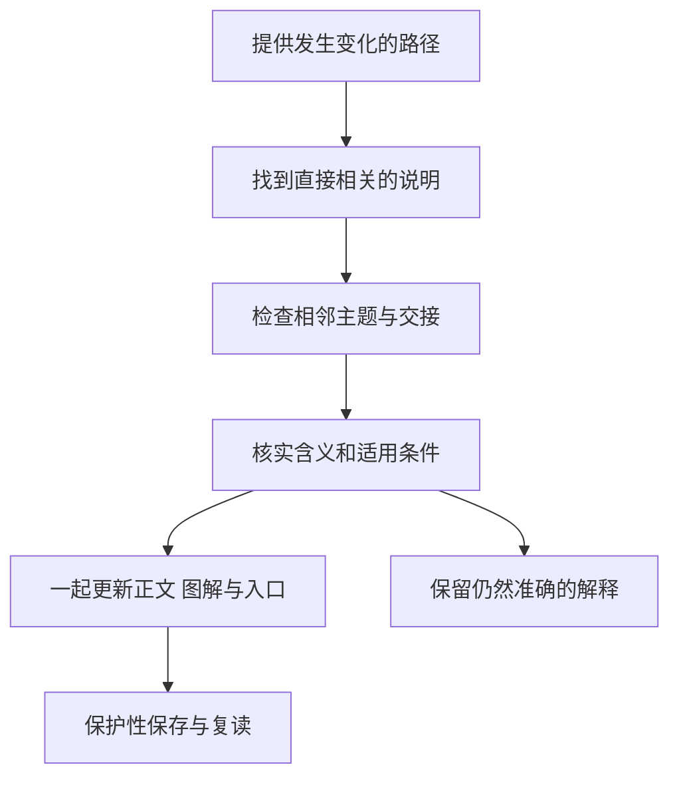

# 代码变了，哪些知识需要一起检查

改动一个实现文件，可能影响几篇说明，也可能不改变任何业务含义。Lumine 先利用已经登记的来源、主题范围和文档关系，给出需要核对的位置；Agent 再阅读相关实现，判断哪些解释必须更新。

这种分工让日常维护有明确起点，又不会因为一个文件变化就重写整库。知识页面中的人工修正、有效规则和仍然准确的解释，应在调查后继续保留。

<a id="from-change-to-explanation"></a>
## 从一个变化走到完整解释



```lumine-view
version: 1
type: steps
id: impact-walkthrough
diagram: impact-path
items:
  - id: locate
    title: 先找到直接相关的说明
    body: 调用方提供仓库身份和变化路径，包括已经删除的文件。工具依次检查页面登记的来源、监控范围，以及知识主题的来源范围，返回直接候选。它不在这一步重新扫描整仓，也不会修改知识正文。
    nodes: [changed, direct]
    source: impact-source
  - id: connect
    title: 再核对相邻主题
    body: 一篇说明可能与操作指南、上游机制或长期决定有关。工具沿已登记关系向两侧各查一层，把这些邻接页面作为调查提示；不会把整张关系网都认定为受影响。直接候选对应的章节与图解也会列出，方便从准确位置开始读。
    nodes: [related]
    source: impact-source
  - id: understand
    title: 判断含义是否真的变化
    body: Agent 对照实际实现、测试、配置和适用规范。只是改了格式时，现有解释可以保留；如果状态、权限、错误处理或交接改变，就需要同步相应的结论、条件与例外。登记路径未命中的变化会单独列出，仍需判断它是否代表新的知识主题。
    nodes: [investigate, retain]
    source: maintenance-skill
  - id: explain
    title: 维护读者实际看到的整组内容
    body: 更新不止修改一句正文。相关摘要、图示、导航、术语和来源也要保持一致。工作包带上当前正文、生成基线、人工修订与阅读意图；保存时进行三方比较，遇到冲突保留双方内容，不能用新生成文本覆盖人工判断。最后从原来的阅读入口重新解释一次这个机制。
    nodes: [revise, save]
    source: update-source
```

<a id="why-one-hop"></a>
## 为什么相邻页面只是候选

关系说明两篇内容值得一起考虑，不证明它们在这次修改中一定都错了。例如，机制说明引用的实现发生变化，操作指南可能也要改；如果操作入口和行为保持不变，指南便可以保留。

继续把操作指南的所有关联页面都列为“受影响”，会让一个局部变化变成全库任务。因此当前工具只扩展直接候选的一层关系。需要追踪更远时，Agent 应沿已核实的业务链继续调查，而不是靠关系数量决定改写范围。

```lumine-view
version: 1
type: explainer
id: impact-experiment
title: 观察直接命中与相邻关系的区别
asset: knowledge-impact-explorer
text: |
  下面使用三篇示例说明表示一条知识关系链。改变“机制说明”的来源，只会直接命中机制说明，并提醒核对与它相邻的操作指南；专题说明隔了两层，不会自动进入候选。

  如果改变“操作指南”的来源，它两侧的机制说明和专题说明都会作为相邻候选。取消一条登记关系后，该方向不再自动提示。选择没有登记范围的文件时，工具会报告未命中，仍需由 Agent 判断知识缺口。
height: 590
```

<a id="keep-meaning-complete"></a>
## 哪些判断不能交给路径匹配

```lumine-view
version: 1
type: comparison
id: automation-and-judgment
columns:
  - id: runtime
    title: 工具提供的依据
  - id: agent
    title: Agent 继续完成的判断
rows:
  - label: 来源变化
    values: [哪些页面引用了这个路径，以及对应的章节和图解。, 变化是否影响行为、条件、限制或例外。]
  - label: 相邻主题
    values: [已登记的依赖、关联和主题包含关系。, 跨模块交接是否改变，是否需要继续追踪更远。]
  - label: 工程规范
    values: [规范的完整阅读入口和适用范围。, 当前操作必须遵守哪些规则，不能据旧代码放宽规范。]
  - label: 维护结果
    values: [保存候选时检查输入与三方差异，并保留冲突。, 正文、图解和入口是否共同解释了当前机制。]
```

没有路径命中，不等于没有知识影响；文件没有变化，也不等于原解释必然正确。用户纠正概念、补充重要条件或指出阅读困难，同样可以触发知识维护。此时从问题和现有页面出发调查即可，不必先制造一次代码变化。

普通知识同步不能改变工程规范的约束含义。涉及规则修订时，要保留其适用范围、条件与否定，并按照当前授权处理。只读问题中发现缺口应报告，不因此开始改写文件。

<a id="starting-with-a-question"></a>
## 还没有明确改动时，从问题进入

接到“调整这个机制”一类任务时，Agent 可以先用 `wiki context` 查询当前问题。返回内容把相关章节、相邻主题和完整规范入口放在一起，帮助选择下一步调查方向；它不生成答案，也不代替必须读取的规则全文。

有明确文件或章节时，可以直接沿来源核实，不要求每次都从检索开始。后续执行得到真实变化后，再用影响候选检查知识是否跟上。这样，开始任务时的理解与完成任务后的维护使用同一份知识，而不是两套不断复制的摘要。

更详细的操作与恢复规则见 [Wiki 扫描、检索、增量更新与阅读](lumine-wiki)。

<!-- lumine-wiki-metadata:v1
{
  "reading": {
    "question": "修改代码以后，Lumine 怎样帮助 Agent 找到需要维护的知识？",
    "audience": "维护项目及知识库的开发者",
    "purpose": "理解自动定位与语义判断的分工，知道何时扩大调查、何时保留现有解释。"
  },
  "tags": [
    "知识维护",
    "影响分析",
    "上下文"
  ],
  "aliases": [
    "增量知识",
    "impact",
    "context"
  ],
  "repositories": [
    "project"
  ],
  "sources": [
    {
      "id": "impact-source",
      "repoId": "project",
      "path": "skills/lumine-harness/src/harness/wiki/context.ts",
      "title": "上下文与知识影响分析",
      "note": "定位直接候选、扩展一层关系，并提供完整规范的阅读入口。"
    },
    {
      "id": "update-source",
      "repoId": "project",
      "path": "skills/lumine-harness/src/harness/wiki/engine.ts",
      "title": "Wiki 工作包与保护性保存",
      "note": "准备阅读意图、现有内容、来源和人工修改，应用候选时保留冲突。"
    },
    {
      "id": "writing-guide",
      "repoId": "project",
      "path": "skills/lumine-harness/assets/skills/lumine-knowledge/references/写作与编排.md",
      "title": "从调查到可读的解释",
      "note": "Agent 的调查、综合、写作与复读方法。"
    },
    {
      "id": "maintenance-skill",
      "repoId": "project",
      "path": "skills/lumine-harness/assets/skills/lumine-knowledge/SKILL.md",
      "title": "项目知识 Skill",
      "note": "本轮授权、完整规则读取、知识维护与语义核实的职责。"
    }
  ],
  "relations": [
    {
      "target": "lumine-wiki",
      "kind": "related",
      "note": "了解扫描、更新、三方比较及恢复的完整机制。"
    },
    {
      "target": "lumine-wiki-reader",
      "kind": "related",
      "note": "查看知识如何以正文、图解与来源呈现给读者。"
    }
  ],
  "diagrams": [
    {
      "id": "impact-path",
      "title": "从变化到可读知识的维护路径",
      "caption": "工具缩小调查范围；是否改写、怎样解释，仍由 Agent 结合实际来源判断。",
      "sources": [
        "impact-source",
        "update-source",
        "maintenance-skill"
      ]
    }
  ],
  "sections": [
    {
      "id": "from-change-to-explanation",
      "sources": [
        "impact-source",
        "update-source",
        "maintenance-skill"
      ]
    },
    {
      "id": "why-one-hop",
      "sources": [
        "impact-source"
      ]
    },
    {
      "id": "keep-meaning-complete",
      "sources": [
        "update-source",
        "writing-guide",
        "maintenance-skill"
      ]
    },
    {
      "id": "starting-with-a-question",
      "sources": [
        "impact-source",
        "maintenance-skill"
      ]
    }
  ],
  "watchScopes": [
    {
      "repoId": "project",
      "path": "skills/lumine-harness/src/harness/wiki"
    }
  ]
}
-->
