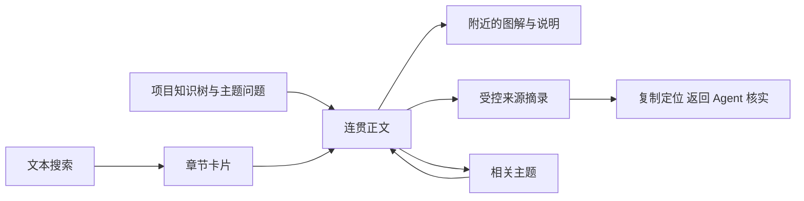

# 知识树、图解与来源阅读

## 从项目问题进入机制说明

当前阅读界面由 React TSX 入口组织首页、主题、正文与来源面板，搜索、Markdown 呈现和图解分别由组件承载；它们共享同一份 Wiki 正文。首页优先展示项目总览、主要功能与业务场景，把更深入的实现主题放在继续了解的位置；具体入口来自项目自己的阅读目录，不固定套用某个业务系统的模块。侧栏按理解项目、开发与运行、查找与核实组织。正文旁可以展开本页目录，从章节进入证据，再回到原阅读位置。未启用编排的项目仍可读现有正文。卡片和列表用于浏览与搜索，章节命中进入对应位置，关联区能继续进入依赖、决策或相关内容。搜索默认只查 Wiki；主动切换到全部范围才纳入 Spec、Plan 和逐文件登记的验证材料，浏览器通过继续加载查看后续结果。

阅读位置和目录展开状态保存在当前浏览器会话的 sessionStorage，并按项目 `projectId` 隔离；关闭图查看器恢复原滚动位置，浏览器后退和前进处理页面路由。服务切到另一项目，或刷新时无法确认原项目身份，会清理上一项目的页面与对话框状态并回到首页。它不是跨设备阅读同步。阅读器面向桌面使用；现有样式在较窄窗口会将目录收进可关闭的侧栏，在中等桌面窗口收起右侧目录，保留正文行宽；小窗口和桌面缩放时收起导航，完整字号保留。可切换专注阅读隐藏辅助区域。页面导航与后退将焦点移到主内容，章节定位聚焦对应标题，键盘仍可遍历目录、本页锚点和对话框。界面默认使用项目语言，切换语言只切换控件说明，不翻译或隐藏正文。

代码块和超宽表格在各自区域内横向滚动；正文中的长路径可以换行。表格单元格保留最小可读宽度，长标识符不强行逐字换行，避免为把全部列挤进正文而形成细长的文字列。局部滚动保留完整内容，读者可以按列查阅。

文件改名保留文档 ID，旧路径指向同一身份；已经登记的旧文档或旧章节映射由本地服务解析，精确章节映射优先于整篇映射。阅读器取得完整正文和当前引用，用替换当前历史项的方式规范 URL，再定位标题；后退不会额外经过一个别名页面。同页旧章节链接也进入这一解析路径。没有可靠映射的片段给出失效提示，正文与有效目录仍可阅读。正文版本未变时不重建节点，避免规范引用后的再次请求清掉章节焦点。定位章节或图解后，阅读器观察正文布局变化，使前方按需绘制的图解不会把目标推离屏幕，并只在第一次定位时聚焦目标。用户滚轮、触摸、按下指针或使用导航键后停止自动定位，后续绘图不会抢回读者位置。

## 来源与审阅帮助读者判断能否依赖

正文头部保留简短适用状态与查证入口，未核对来源采用低强调提示；明确冲突或来源缺失仍可见。详细来源观察与语义审阅放在来源区域。上次来源未变只表示已保存观察与基线一致，不等于刷新页面时重新扫描源码，也不证明解释正确。清缓存或换 clone 后，缺少匹配本机核对记录时显示尚待核对；登记来源仓库缺失时显示来源缺失，不能把复制来的旧观察当成本机已核实。历史核对时间和语义审阅仍可查看。作者核对和独立审阅分开标识；正文或来源版本变了，旧审阅不能继续显示适用。

正文先保持连贯阅读。章节、图解和整篇页面的来源默认折叠，读者需要核实某个判断时再展开。来源名称优先使用资料自身或已登记的可读标题；没有标题时先使用简短关联说明，再回退到可识别的文件名。资料保留原有语言，界面控件随项目语言或读者选择变化，不把内部来源编号硬翻译为中文标题，也不把“guide”“round”等编号当作资料名称。稳定编号仍负责内部关联。

来源面板只读取当前文档已登记的资料。完整引用的 Markdown 默认呈现为文档，可切换查看原文；代码与局部摘录保留行号和当前引用范围。“版本与定位”折叠保存仓库身份、相对路径、内容指纹、知识基线和读取时间，供进一步核实。指纹针对文件内容，可以反映未提交修改；它不是已部署版本证明。缺少来源仓库时已有 Wiki 仍可读，来源面板明确不可用，不把缺失标为最新。

章节可登记自身 sources，使依据靠近相关解释。来源与参考文档拥有可复制的阅读链接；刷新、浏览器前进后退或在新标签页打开时，能回到同一资料，关闭面板后继续阅读正文。复制源码定位则用于回到 Agent 进一步调查，不会执行任意文件链接。Spec、Plan 与验证 Markdown 通过受控目录引用打开，资料内的相对链接以该资料位置解析。方案和计划保留自身的文档身份，不能因默认状态而标为“当前实现”；拟议和历史状态仍需区分。没有独立文档身份的附件不会因此被宣称已经审阅。

## 图解来自文本，显示失败也能读

卡片为可选择、搜索、复制的 HTML 文本。Mermaid 源码保存在 Markdown 中，进入可见区域或用户请求预览时才绘制。浏览器会产生 SVG DOM，但不把它保存成知识真源、索引图片或模型输入；绘图不调用模型。正文说明、图名、适用状态和来源独立可读，纯文本模型可以理解关系并维护图源码。

图查看器提供缩放、平移、适合窗口、重置、稳定引用、源码复制和 Mermaid 文本导出。放大层中的“复制 Mermaid 源码”直接复制当前图的完整文本，剪贴板不可用时显示准确的手动复制文本。键盘加减键调整缩放，方向键移动，0 适合窗口，Escape 关闭。用户主动导出 SVG 时，浏览器添加标题、状态、正文版本与身份，并清除脚本、链接及远程资源引用；这是显式本地导出，不进入普通知识生产流程。

严格 Mermaid 配置禁用 HTML 标签。图规模上限为 50,000 字符和 300 条受计数边，拒绝自定义配置、click、脚本和远程地址；错误或超限显示反馈并保留源码，不绘制截断图。实际修改应拆成总览和专题，不能通过提高限制掩盖不可读的密集关系网。

## 让文字、图与代码共同解释问题

中文标题使用Noto Serif SC，正文使用Noto Sans SC，代码用IBM Plex Mono并让中文注释回退正文。字体随离线资源发行，浏览器按实际字符需要加载分片；正文先用回退字体可读，不等待完整中文字库。

文章以自然段解释机制。确实需要顺序、对齐比较、就地术语或代码时，使用明确的lumine-view围栏；普通冒号和来源行号不再参与扩展语法解析。步骤与图中节点可以联动定位，代码在说明下展开，实际来源保持原行范围。完整示例见[代码变化如何定位知识影响](reader-explanation)。

专题解释器使用项目登记的静态资源，放在没有同源权限的隔离框架中运行。脚本只能操作解释页面，不能访问宿主数据或网络，也不能提交业务写入。解释器加载失败时，完整文字仍可阅读；它展示的是被说明的机制，不是生产操作入口。

## 本地服务的访问边界

`wiki serve` 只监听回环地址，HTTP 仅接受 GET／HEAD，校验 Host 和 Origin。扫描、来源与 HTTP 共用登记根、忽略规则和真实路径检查，符号链接不能绕过允许范围。静态资源限定可用扩展名和文件路径，错误响应不泄露本机绝对路径或堆栈。

Markdown 通过受控 AST 渲染，普通 HTML 和外部图片不执行或加载。声明式展示块保留可检索的等价文本，Mermaid 输出再次清洗。代码高亮由本地Node服务按内容缓存，仅加载选定语言，浏览器接收保真文本与颜色；未知语言或高亮失败退回纯文本。`build-reader.ts` 从 React TSX 入口构建浏览器资源，将脚本、样式、动态 chunk、许可和内容清单放入本地分发包；服务端内容安全策略限制外部资源。构建会核对并保留清单登记的旧 chunk 与许可旁文件，合并既有许可汇总，先安放新资源，再原子切换稳定的 `reader.js` 入口，最后更新清单。这样旧入口已在浏览器中时仍能加载对应 chunk；历史资源会累积，回滚后已打开的新入口不能保证其按需图解继续加载。服务不会提供写 API、后台模型聊天或独立绘图编辑器；修改正文仍回到当前 Agent 与 Wiki 更新流程。

## 遇到错误与未完成内容时怎么继续

读者导航表示知识的主要位置。写作覆盖进度留在维护入口，语义验收见实际审阅记录。部分主题未完成、引用内容缺失、目录关系异常或某篇解析失败分别展示；可复制继续整理指令。页面切换取消旧文档请求；刷新项目数据后，旧文档响应也必须匹配当前加载版本，搜索另核对请求顺序，避免旧结果覆盖新导航。跨文档加载失败时只显示当前页的错误与重试，不沿用上一篇正文；加载、空结果、失败和重试均可见。

源码变化请执行适用扫描或让 Agent 直接核实，单纯刷新阅读器不重新解释代码。无可靠搜索结果时可换术语或从目录进入，不用无关卡片凑数。浏览器存储不可用时正文和搜索仍可用，但界面偏好与阅读位置不能跨刷新保留；剪贴板拒绝时会给出提示和可手动选取的文本。图语法错误或超限时显示图解错误并保留 Mermaid 文本，修订由 Agent 改源码；图解模块或图种动态资源载入失败时，显示“重新载入阅读器”入口，服务恢复后整页重载当前引用并重新获取阅读脚本。顶栏“刷新”只重新读取项目数据，不能替代资源失效后的整页重载。页面不存在“后台 AI 修复”按钮。

验证阅读器要覆盖真实目录进入章节、源码指纹对比、相关主题、返回位置、窄屏键盘以及错误图。正式分发无源码仓依赖、无缓存、断网时仍应读取既有正文并显示图解；此页描述实现与检验方法，实际浏览器验收另见 Validation，不能由静态代码推断用户已接受。

<!-- lumine-wiki-metadata:v1
{
  "tags": [
    "reader",
    "阅读器",
    "目录",
    "Mermaid"
  ],
  "aliases": [
    "reader",
    "阅读器",
    "目录",
    "Mermaid",
    "source reference",
    "图解",
    "serveWiki",
    "openDocument"
  ],
  "repositories": [
    "project"
  ],
  "sources": [
    {
      "id": "reader",
      "repoId": "project",
      "path": "skills/lumine-harness/src/browser/reader.tsx",
      "startLine": 1,
      "endLine": 553,
      "kind": "source",
      "title": "阅读器界面与阅读位置",
      "note": "首页内容优先级、来源面板、复制阅读链接及浏览器历史行为。"
    },
    {
      "id": "reader-model",
      "repoId": "project",
      "path": "skills/lumine-harness/src/harness/wiki/reader-model.ts",
      "startLine": 1,
      "endLine": 47,
      "kind": "source",
      "title": "阅读器知识数据"
    },
    {
      "id": "server",
      "repoId": "project",
      "path": "skills/lumine-harness/src/harness/wiki/server.ts",
      "startLine": 1,
      "endLine": 205,
      "kind": "source",
      "title": "本地阅读服务与来源读取"
    },
    {
      "id": "files",
      "repoId": "project",
      "path": "skills/lumine-harness/src/harness/wiki/files.ts",
      "startLine": 1,
      "endLine": 203,
      "kind": "source",
      "title": "来源快照与路径边界"
    },
    {
      "id": "build",
      "repoId": "project",
      "path": "scripts/build-reader.ts",
      "startLine": 1,
      "endLine": 199,
      "kind": "source",
      "title": "阅读器资源构建"
    },
    {
      "id": "engine",
      "repoId": "project",
      "path": "skills/lumine-harness/src/harness/wiki/engine.ts",
      "startLine": 1,
      "endLine": 484,
      "kind": "source",
      "note": "历史观察与本机核对记录分离",
      "title": "知识扫描、更新与审阅"
    },
    {
      "id": "reader-common",
      "repoId": "project",
      "path": "skills/lumine-harness/src/browser/reader-common.ts",
      "startLine": 1,
      "endLine": 225,
      "kind": "source",
      "title": "阅读地址、来源名称与界面语言",
      "note": "来源使用真实标题，链接记录可恢复的阅读位置，控件说明随界面语言变化。"
    },
    {
      "id": "reader-search",
      "repoId": "project",
      "path": "skills/lumine-harness/src/browser/reader-search.tsx",
      "startLine": 1,
      "endLine": 124,
      "kind": "source",
      "title": "知识检索界面"
    },
    {
      "id": "reader-markdown",
      "repoId": "project",
      "path": "skills/lumine-harness/src/browser/reader-markdown.tsx",
      "startLine": 1,
      "endLine": 262,
      "kind": "source",
      "title": "正文、图解与来源链接呈现",
      "note": "章节与图解的来源按需展开；Markdown 资料使用受控阅读视图。"
    },
    {
      "id": "reader-diagrams",
      "repoId": "project",
      "path": "skills/lumine-harness/src/browser/reader-diagrams.tsx",
      "startLine": 1,
      "endLine": 182,
      "kind": "source",
      "title": "图解绘制与阅读操作"
    },
    {
      "id": "reader-styles",
      "repoId": "project",
      "path": "skills/lumine-harness/src/browser/styles.css",
      "startLine": 1,
      "endLine": 320,
      "kind": "source",
      "title": "阅读器排版与视觉样式"
    },
    {
      "id": "references",
      "repoId": "project",
      "path": "skills/lumine-harness/src/harness/wiki/references.ts",
      "startLine": 1,
      "endLine": 20,
      "kind": "source",
      "title": "文档与章节引用解析"
    },
    {
      "id": "document-operations",
      "repoId": "project",
      "path": "skills/lumine-harness/src/harness/core/document-operations.ts",
      "startLine": 107,
      "endLine": 201,
      "kind": "source",
      "title": "文档改名与归档"
    },
    {
      "id": "view-blocks",
      "repoId": "project",
      "path": "skills/lumine-harness/src/harness/wiki/view-blocks.ts",
      "title": "受控内容块协议"
    },
    {
      "id": "reader-article",
      "repoId": "project",
      "path": "skills/lumine-harness/src/browser/reader-article.tsx",
      "title": "文章解释组件"
    },
    {
      "id": "highlight",
      "repoId": "project",
      "path": "skills/lumine-harness/src/harness/wiki/highlight.ts",
      "title": "服务器代码高亮"
    },
    {
      "id": "explainers",
      "repoId": "project",
      "path": "skills/lumine-harness/src/harness/wiki/explainers.ts",
      "title": "专题资源访问边界"
    },
    {
      "id": "reader-fonts",
      "repoId": "project",
      "path": "skills/lumine-harness/src/browser/fonts.css",
      "title": "离线字体入口"
    }
  ],
  "relations": [
    {
      "target": "lumine-wiki",
      "kind": "depends_on",
      "note": "正文、章节、目录和审阅由同一知识协议提供"
    },
    {
      "target": "lumine-architecture",
      "kind": "related",
      "note": "浏览器资源独立构建并自包含分发"
    }
  ],
  "watchScopes": [
    {
      "repoId": "project",
      "path": "skills/lumine-harness/src/browser/reader.tsx"
    },
    {
      "repoId": "project",
      "path": "skills/lumine-harness/src/browser/reader-common.ts"
    },
    {
      "repoId": "project",
      "path": "skills/lumine-harness/src/browser/reader-search.tsx"
    },
    {
      "repoId": "project",
      "path": "skills/lumine-harness/src/browser/reader-markdown.tsx"
    },
    {
      "repoId": "project",
      "path": "skills/lumine-harness/src/browser/reader-diagrams.tsx"
    },
    {
      "repoId": "project",
      "path": "skills/lumine-harness/src/browser/styles.css"
    },
    {
      "repoId": "project",
      "path": "skills/lumine-harness/src/harness/wiki/reader-model.ts"
    },
    {
      "repoId": "project",
      "path": "skills/lumine-harness/src/harness/wiki/server.ts"
    },
    {
      "repoId": "project",
      "path": "skills/lumine-harness/src/harness/wiki/files.ts"
    },
    {
      "repoId": "project",
      "path": "skills/lumine-harness/src/harness/wiki/engine.ts"
    },
    {
      "repoId": "project",
      "path": "scripts/build-reader.ts"
    },
    {
      "repoId": "project",
      "path": "skills/lumine-harness/src/harness/wiki/references.ts"
    },
    {
      "repoId": "project",
      "path": "skills/lumine-harness/src/harness/core/document-operations.ts"
    }
  ],
  "diagrams": [
    {
      "id": "reading-flow",
      "title": "从目录到具体依据",
      "caption": "先读正文和图解，需要核实时展开来源；阅读链接可保留定位，浏览器不会调用模型或改写知识。",
      "sources": [
        "reader",
        "server",
        "reader-model"
      ]
    }
  ],
  "sections": [
    {
      "id": "知识树图解与来源阅读",
      "sources": []
    },
    {
      "id": "reading-navigation",
      "sources": [
        "reader",
        "reader-model",
        "reader-search",
        "reader-styles",
        "server",
        "engine",
        "references",
        "document-operations"
      ]
    },
    {
      "id": "reader-evidence",
      "sources": [
        "reader",
        "server",
        "engine",
        "reader-common",
        "reader-markdown"
      ]
    },
    {
      "id": "text-diagrams",
      "sources": [
        "reader-markdown",
        "reader-diagrams"
      ]
    },
    {
      "id": "read-only-service",
      "sources": [
        "server",
        "reader-common",
        "build"
      ]
    },
    {
      "id": "reader-failures-and-validation",
      "sources": [
        "reader",
        "reader-search",
        "reader-markdown",
        "reader-diagrams",
        "reader-common"
      ]
    }
  ]
}
-->
