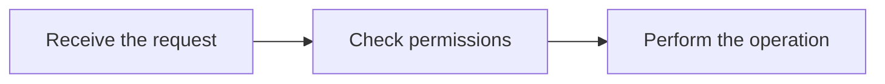

# Explain mechanisms with readable, useful interaction

Choose the explanation before choosing a component. Paragraphs explain conclusions, conditions and reasons; Mermaid explains order and relationships; aligned comparisons explain differences along shared dimensions. Use an interactive explainer only when changing conditions and observing outcomes helps the reader. A normal article does not need to become a component showcase.

Markdown remains the sole knowledge source. Text inside declarative blocks is also available to search and agents; the reader supplies layout, numbering, highlighting and diagram coordination. Ordinary colons, parentheses, line numbers and code are never treated as directives.

## Basic contract

Extensions use a code fence named exactly `lumine-view`, containing YAML. Required fields are `version: 1`, `type` and `id`; `title` is optional. Stable IDs start with an ASCII letter and contain letters, digits, dots, underscores or hyphens. Visible titles and explanations follow the project language. Keep internal IDs out of natural prose.

Each block explains one thing. Correct unknown fields, duplicate IDs, unsupported versions and misaligned comparison rows rather than bypassing validation. The browser preserves an invalid block as original text and executes no HTML or script from it. Run the applicable Wiki check and read the actual page after editing.

For external deep links, prefer a stable section surrounding the block: place `<a id="stable-section-id"></a>` before its Markdown heading. Do not use a changing title or step number as a permanent reference.

## 1. Coordinate steps with a diagram

Write the Mermaid diagram and register its stable ID, title, caption and sources in the page's `diagrams` metadata. The following example connects three steps to three diagram nodes. `nodes` must exactly match those node IDs. This demonstrates writing; it does not establish that another project follows this process.

````markdown


```lumine-view
version: 1
type: steps
id: request-walkthrough
title: Checks along a request path
diagram: request-path
items:
  - id: receive-request
    title: Identify the object
    body: The entry point checks required parameters and determines the object this operation concerns.
    nodes: [receive]
  - id: authorize-operation
    title: Check operation permissions
    body: Authorization considers both identity and object scope. Failure stops the operation before business logic runs.
    nodes: [authorize]
    source: authorization-source
  - id: execute-operation
    title: Perform the operation
    body: Business logic runs only after those checks. The operation result determines whether it succeeded.
    nodes: [execute]
```
````

The component presents actual sequence. Selecting “Locate this step in the diagram” highlights its related nodes; all explanation text remains visible. Steps may omit a diagram. Do not associate irrelevant nodes merely to add interaction.

`items` accepts up to 20 entries, each with `id`, `title` and `body`. The body supports ordinary Markdown, without nesting another view block. An optional `source` must refer to a source registered on this page. A step may include a `code` object, using the fields described below.

## 2. Compare along shared dimensions

A comparison should explain the consequences of differences. Columns are the objects being compared; rows are shared questions. Each row's `values` corresponds exactly to `columns`. Two unrelated summaries in cards do not make a useful comparison.

```lumine-view
version: 1
type: comparison
id: reading-and-observation
title: What reading and source checks each establish
columns:
  - id: read
    title: Reading knowledge
  - id: observe
    title: Checking source changes
rows:
  - label: Available information
    values:
      - Saved explanations, relationships and source locations.
      - Changed sources and clues that need further assessment.
  - label: What does not follow
    values:
      - Successfully reading a page does not prove its source code is unchanged.
      - A changed file does not prove that business behavior changed.
```

The limit is four columns and 30 rows. Wide tables scroll independently without shrinking article text. Search text preserves each compared object and its value.

## 3. Explain a term in place

Use this for a supporting term that only some readers need. Explain essential concepts and conditions directly in the prose instead of hiding them all.

```lumine-view
version: 1
type: term
id: generated-baseline
term: What is the generated baseline?
meaning: The last generated text that was successfully saved. It supports a three-way comparison with the current text, including human edits, and the new candidate. The current document cannot substitute for it.
```

## 4. Expand implementation after explaining it

Code must support the nearby conclusion. The language identifier selects highlighting without changing content. A source references a stable ID in this page's `sources`; its readable title or path supplies the visible label.

````markdown
```lumine-view
version: 1
type: code
id: relation-boundary
title: Why only directly related topics are checked
caption: The impact propagation boundary
language: ts
source: impact-source
collapsed: true
code: |
  const directlyAffected = new Set(reasons.keys());
  for (const edge of edges) {
    if (directlyAffected.has(edge.from)) {
      add(edge.target.split('#')[0], 'relation', `${edge.from}:${edge.kind}`);
    }
  }
```
````

Preserve code verbatim. Register its file and line range in `sources`. State what an excerpt omits; do not imply an abbreviated snippet is the full implementation. Failed highlighting preserves plain code. Copying returns original characters without line numbers or highlight markup.

Ordinary code fences already support highlighting and copying. Use this block only when a title, source or collapsed presentation helps the reader. The same `language`, `code`, `caption` and `source` fields can appear in a step's `code` object.

## 5. Supporting explanation

```lumine-view
version: 1
type: details
id: why-not-rewrite-all
title: Why a change does not trigger rewriting the whole Wiki
body: |
  A file change can be limited to comments or formatting. Assessing the impact first preserves correct explanations and human revisions.

  When cooperation between modules actually changes, maintain their text, diagrams and entry points in the same scope.
```

Collapse supporting reasoning, uncommon exceptions or deeper implementation. Keep critical rules and choices visible by default.

## 6. Specialized interactive explainers

An explainer is a project-owned static HTML file with inline CSS and JavaScript. It requires no TSX build setup in the business project. Register it in `assets/registry.json` under the configured Wiki root; do not place arbitrary URLs in a view block.

```json
{
  "schemaVersion": 1,
  "entries": [
    {
      "id": "impact-explorer",
      "documentId": "knowledge-impact",
      "path": "impact-explorer.html",
      "title": "Which knowledge needs review after a source changes",
      "text": "Match sources, watched scopes or topic scopes directly, then review adjacent explanations. A candidate does not establish that rewriting is necessary."
    }
  ]
}
```

`path` is relative to `assets/`. A page can use only its registered explainers. Paths, symbolic links and network requests must not expose other project material. Registration text and article text must agree; an interactive result is not an independent knowledge source.

```lumine-view
version: 1
type: explainer
id: impact-conditions
title: Change a condition to see where investigation starts
asset: impact-explorer
text: |
  A source change first matches explanations that directly refer to that source, then suggests checking adjacent topics.
  Unmatched files are reported separately. An absent match does not prove there is no knowledge impact.
input:
  changed: source
height: 480
```

Every explainer requires complete `text`. Inputs contain at most 20 scalar values. The isolated iframe has no host same-origin access and cannot read project credentials, invoke business services, use external networks or perform real writes. Never add `allow-same-origin`.

An explainer may receive `lumine:input` from its parent, containing `asset`, `input`, `locale` and `theme`. It may send `lumine:ready`, or `lumine:resize` with a height from 180 to 900 pixels, always including its registered `asset`. The parent accepts messages only from the current iframe; the explainer accepts messages only when `event.source === parent`. Inputs are display conditions, never executable code or paths.

Use warm white, dark text, restrained warm emphasis and readable type. Controls require labels and visible keyboard focus. Results explain why they changed. The complete textual mechanism remains readable if the explainer fails.

## Migrate old display directives

Ordinary colons are no longer parsed as directives. Read each existing `:::steps`, `:::comparison` and `:::details` block and retain its unique text. Convert actual sequences to `steps`, shared comparison dimensions to `comparison`, and supporting text to `details`. Use normal paragraphs or lists where no component is needed.

Use the existing Wiki update packet to save conversion, preserving document identity, stable sections, human content, sources and recovery evidence. Do not infer old block structure through global text replacement or delete original text and regenerate it from a summary. After conversion, check ordinary colons, file line references, punctuation, code characters, diagrams and sources, then read the page from its normal entry point.
