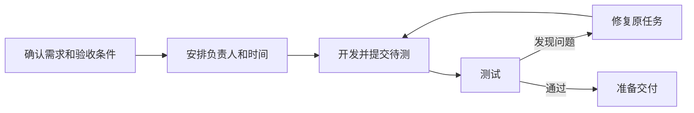

# 从调查到可读的解释

本指南适用于首次建库和日常修订。目标是让读者理解一个真实问题，不是证明作者读过很多文件。下面的示范采用虚构项目，不可当作当前仓库事实；实际工作必须替换为调查所得的条件和来源。

## 写之前先取得足够输入

围绕当前问题准备一份小而完整的输入：读者是谁、需要回答什么、页面负责解释什么；相关章节和实际来源；入口到结果的关系；适用的完整规范；本次变化及人工修订。优先复用既有主题和稳定ID，不由某条提示中的菜单名单决定整库结构。

可用 `wiki context "问题" --json` 获取起始上下文，再沿返回的章节、关系与来源调查。代码变化使用 `wiki impact` 的帮助确认输入格式。工具返回相关候选和原文位置，不替你判断业务已变化；未找到内容时回到源码，不凭空补摘要。问题只涉及一处明确实现时可以直接读源码，不必走固定命令链。

## 七步工作法

1. 用一句话确定要解释的问题，先从读者现有入口尝试回答。
2. 阅读入口、核心实现、调用方、测试、配置及适用规范。顺着真实调用或角色交接追踪，不能用同名目录证明依赖。
3. 列出主要结论及成立条件：谁触发、何时有效、正常结果、拒绝／失败、恢复方式；将事实、计划和推断分开。
4. 按理解顺序写提纲。先给足够的整体认识，再介绍需要的概念与机制，最后提供更细实现。历史只在能解释当前选择时出现。
5. 选择表达。关系和顺序需要图；对应项需要比较；可操作条件确实能帮助理解时用解释器。普通解释优先自然段，不给每页硬塞图或表。
6. 修改整组受影响内容：正文、摘要、图、导航、术语、关系及来源。已有人工修正保留；重要规则的适用范围、否定和例外不得缩写掉。
7. 从陌生读者角度复读，再核对关键结论。每处问题反馈定位到具体句子、条件或入口，直接修正；不要把评分表、未完成检查单、内部来源编号写进正文。

复读时能够回答“为什么、何时、接下来、失败怎么办、会影响谁”，比章节数更重要。核实不出的关键结论应继续调查或删去无依据的断言；必要限制简洁说明，不用大量“待核实”徽章代替工作。未取得独立模型或用户评价时如实说明验证边界，不宣称较弱模型必然达到同等效果。

## 业务说明：解释交接，而非翻译菜单

**待改写**

> 系统有项目、排期、任务、测试模块。项目模块维护项目；排期模块管理计划；任务模块处理任务；测试模块管理测试。通过projectId、taskId关联。

**调查所得（示例）**

需求经项目负责人确认后才可安排开发；排期分配负责人和时间，不自动创建第二份任务；开发提交待测后进入测试队列；失败回到原任务并附缺陷；复测通过才满足交付条件。没有测试结论不能写成已交付。

**改进正文**

### 一项需求怎样走到交付

需求先在项目中确认范围和验收条件。负责人随后安排执行人和时间，团队据此开始工作。排期改变的是同一项工作的安排，开发与测试仍围绕这项工作协作。

开发完成后，执行人提交待测版本和说明，测试人员按验收条件检查。发现问题时，缺陷回到原任务，由开发修复后再次提交。测试通过才说明这次实现满足已检查的条件；发布仍取决于项目的交付安排。

**修改理由**：菜单用于寻找操作，文章解释对象如何流转。图只画已核实的交接，字段留到实现说明。不要把这个示例的生命周期强加到其他项目。

## 技术机制：解释不变量，再定位实现

**待改写**

> 发布读取GraphSnapshot，更新published、currentVersionID和draftVersionID。回滚复制新草稿。不覆盖历史。详情见s3:302、s4:149-219。

**调查所得（示例）**

启动实例时绑定已发布版本；保存草稿不改变已发布快照；发布创建可被新实例选择的版本；回滚只生成草稿，还需发布。实例具体是否允许升级，应单独调查，不能从版本字段猜。

**改进正文**

### 修改流程会影响正在执行的实例吗

在这个实现中，实例启动时选定一个已发布版本，后续按该版本执行。编辑草稿只改变下一次准备发布的内容，因此保存草稿不会改变现有实例的处理路径。

发布使新版本可供后续实例使用。恢复历史版本时，系统先把历史内容复制为草稿；确认并发布后才生效。这保留了历史快照，也让恢复操作经过同一套发布检查。

“实例绑定版本”与“当前默认发布版本”是两件事。判断某次运行使用哪套规则，应查看实例绑定，而不能只看编辑器当前打开的草稿。

进一步核实时，在对应说明下展开启动实例、发布和恢复三个实现片段，显示真实文件职责和行范围。来源内部ID只用于机器链接，不作为正文标点的一部分。

**修改理由**：先回答影响范围，解释版本不变量和生效条件；不随手编造“申请”这一项目未必存在的业务对象。图若不能比这三段文字更清楚，可以不用。

## 工程指南：保留条件、否定和效力

**原规则（示例）**

> 仅在公开导出接口内，经登录与项目成员权限检查后，允许导出当前用户可见字段。管理员也不得导出密钥。调试日志不得记录完整导出内容。

**错误摘要**

> 导出需要登录，管理员可导出全部数据，注意日志安全。

**改进正文**

### 导出数据前的权限边界

公开导出接口必须先验证登录状态与项目成员权限，再按当前用户可见字段生成结果。这两个检查都通过后才能开始读取导出数据。

密钥始终排除在导出结果之外，管理员身份也不构成例外。调试日志不能记录完整导出内容；诊断应使用不含敏感内容的请求标识和结果状态。

本页是规范正文，调用方必须完整读取。示例代码可以展示检查顺序，但不能放宽“成员权限”“可见字段”“管理员无例外”或“日志不记录内容”这四项条件。

**修改理由**：清晰不等于缩短所有文字。安全边界必须保留原规则的条件、否定和适用对象，普通维护不能根据旧代码重定义规范。

## 页面与关系如何调整

- 以读者独立问题拆页。一个模块有多个入口不意味着必须拆成多篇；一篇混合部署、业务状态和历史日志时，按问题分开。
- 公共机制只解释一次，其他页面说明自己的差异并关联；不要复制整段说明。
- 新能力先判断归属，再决定是否建页。模块消失时迁移仍有效概念、更新入链，历史从普通路径退出。
- 跨模块关系必须有含义：哪个结果交给谁、谁依赖哪个条件。仅“相关”且无理由的链接无法帮助影响分析。
- 每轮用原问题复读入口。正文改了但旧图、摘要或相邻页仍给出旧规则，更新尚未完成。

知识更新沿用现有工作包、变更组、三方合并和恢复机制；本指南不建立新的任务或审批流程。
